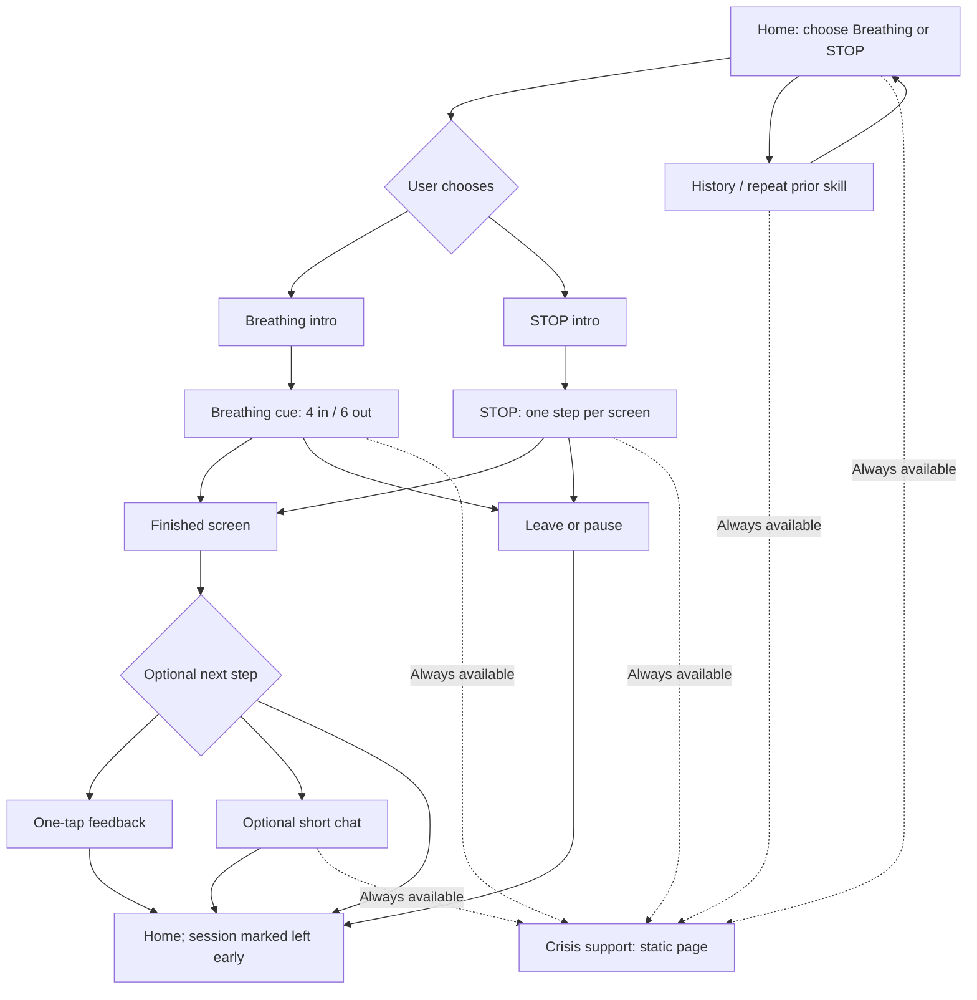

# IST 402 — Assignment 3.1: Research and Design

**Project:** One Step — a mental health skills *coursework prototype*  
**Milestone:** Part 1 (research and design)  
**Submission date:** October 15, 2026  
**Student:** Prothama Sinha  
**Repository:** https://github.com/prothamasinha/one-step  
**Submitted commit:** Pending — add the GitHub commit identifier after uploading this report

> **Scope and disclaimer:** One Step is a class project for practicing interface design and software development. It is **not** therapy, a diagnostic tool, a crisis service, or a system monitored by a professional. All development examples, evaluations, and demonstrations will use fictional scenarios, not real people seeking support.

## 1. What I am proposing

I want to build an application that helps a person practice one short, structured skill without having to read through a long conversation or answer a lot of questions first. The basic idea is simple: someone opens the app, chooses a skill, follows a few clear instructions, and can leave whenever they want. The app should never make the person feel that they failed by stopping.

For this project, I will support **4–6 paced breathing** and the **STOP** skill. These are both included in the research material for the assignment, but they work differently enough to test two interface patterns. Breathing needs a predictable visual pace. STOP needs four short, understandable steps. I am deliberately not including every skill from the study because I would rather make two flows usable and testable than build a large menu with unfinished interactions.

The intended user is a **fictional test character** who may have limited attention or patience when using the interface. My main design question is: **How can the app offer useful guidance while asking as little as possible of the person using it?**

### Goals and boundaries

- Let the user **choose** between breathing and STOP; do not guess their emotional state.
- Keep each exercise at **90 seconds or less at its intended pace**, measured from its first exercise instruction to its final planned step.
- Show one action at a time during an exercise, with an obvious **Pause / Leave** choice.
- Keep **Crisis support** visible and functional on every screen, even if the model or internet connection fails.
- Use a conversational model only for an **optional, short, post-exercise interaction**. The model will not write the steps of a skill, run the timer, evaluate someone's mental health, or decide whether crisis resources are accessible.
- Save minimal fictional session and conversation records so a person can review previous activity and optionally repeat a previously chosen skill.

## 2. Research that shaped the design

The main research source is the [IST 402 Assignment 3 overview, Section 3: Research foundation](https://psu.instructure.com/courses/2484533/pages/assignment-3-overview-mental-health-skills-application). The instructor-provided summary describes feedback from 15 patients, 13 clinicians, and 15 prototype evaluation sessions. Its mention counts show which concerns appeared in that study; they **do not** establish clinical effectiveness. I am using the findings as interface requirements, not as evidence that this prototype improves mental health.

| Finding | Evidence from the provided summary | Decision for One Step |
| --- | --- | --- |
| **R1 — Short duration** | Participants favored about 60 seconds; attention dropped beyond roughly 90–100 seconds (38 mentions). | Design a roughly 70-second breathing flow and a roughly 65-second STOP flow. Measure the full guided sequence, not just the timed middle. |
| **R2 — Frictionless crisis access** | Crisis access came up 30 times across all 15 participants. | Place a clearly labeled **Crisis support** link in the persistent app header. No login, chatbot, or assessment is needed to open it. |
| **R3 — Permission to stop** | Permission to leave was raised 39 times; all 15 participants raised it in that task. | Every exercise screen has **Leave exercise**. Leaving saves an `left_early` status without negative messaging or a completion penalty. |
| **R4 — User-directed journey** | This was the most-mentioned requirement (68 mentions). | Users choose the skill, may skip reflection, and can return home or change skills. There is no automatic routing based on a guessed mood. |
| **D1 — Progressive interface contraction** | The study favored less interface complexity during distress (54 mentions), but did not explain how distress could be detected. | Offer a user-controlled **Simple view** switch that hides optional descriptions and chat prompts. The app never claims to detect distress. |
| **D2 — One atomic skill at a time** | One action per screen was heavily supported (100 mentions). | Show one breathing cue at a time, or one STOP step per screen, rather than displaying the full sequence as a checklist. |
| **D3 — Minimize emotional cost** | The most-mentioned design principle (148 mentions). | No required mood rating, journal entry, account, or written explanation. Optional feedback takes one tap. |
| **D4 — Persistently visible safety** | Participants noticed when support controls disappeared (31 mentions). | The support link stays fixed in the layout during skill screens, chat, history, and error states. |
| **D5 — Personalization without setup work** | People wanted lightweight adaptation without configuration (49 mentions). | After a session, offer **Repeat last skill** on the home screen. This is a suggestion, not an automatic start. |
| **D6 — Calm, non-judgmental interface** | Participants disliked diagnostic language, excessive cheerfulness, saturated color, and demanding motion (97 mentions). | Use short neutral wording, high contrast, restrained colors, an optional reduced-motion mode, and no “streaks,” rankings, or scores. |

The largest trade-off is between making the app convenient and keeping the user in control. Remembering the last selected skill saves a step, but automatically starting it would remove choice. I will **suggest** the last skill and let the user confirm. A similar trade-off applies to D1: I cannot reliably know when someone is distressed, so a visible **Simple view** option is more honest than pretending the software can detect their state.

## 3. Main interaction and screen design

### Proposed user journey



The dotted paths represent the persistent crisis-support control, not something that the user must do to finish the exercise. It will also be available from the intro, completion, interruption, and error screens.

### Rough interface sketch

```text
+--------------------------------------------------+
| One Step                         Crisis support  |
| Coursework prototype; not a crisis service       |
+--------------------------------------------------+
|                                                  |
| Choose what you would like to practice.          |
|                                                  |
| [4–6 Breathing]            [STOP]                |
|                                                  |
| [Repeat last skill]  [History]                   |
|                                                  |
| Simple view: [On/Off]                            |
+--------------------------------------------------+

+--------------------------------------------------+
| One Step                         Crisis support  |
+--------------------------------------------------+
|                                                  |
|                  Breathe in                      |
|                    4 counts                      |
|                                                  |
|          [calm visual ring / text cue]           |
|                                                  |
| [Pause / Resume]          [Leave exercise]       |
+--------------------------------------------------+
```

I will use a restrained visual cue for breathing, but the words **Breathe in** and **Breathe out** will remain readable even when animation is turned off. Buttons will use text labels instead of relying only on icons or color. The interface will be usable with a keyboard, and I will check whether focus moves appropriately between screens.

### Exercise timing and assumptions

**Breathing (intended total: approximately 70 seconds)**

1. First instruction, “Follow the cue at your own pace”: 5 seconds.
2. Six complete cycles of **inhale 4 seconds / exhale 6 seconds**: 60 seconds total.
3. Final planned step and transition, “You can finish here”: 5 seconds.

**STOP (intended total: approximately 65 seconds)**

1. First instruction: 5 seconds.
2. **S — Stop:** 10 seconds.
3. **T — Take a step back:** 10 seconds.
4. **O — Observe what is happening internally and externally:** 20 seconds.
5. **P — Proceed mindfully:** 15 seconds.
6. Final planned step: 5 seconds.

These are **design budgets, not measured results**. The estimate assumes the screen updates without substantial delay and the fictional test user follows the suggested pace. Actual duration will be measured in Part 3.2 from the first displayed exercise instruction through the last planned step, **including any application delays during the sequence**. Entry/skill-selection and setup time will be recorded separately. User-selected pauses and time spent viewing crisis resources are excluded from the exercise-duration measure, as specified in the assignment. STOP will use a visible **Next** control; if someone chooses to remain on a step, the app will not force them forward or penalize them for taking longer.

### Interruptions and errors

- **Leave:** Exit immediately to home; optionally record the session as `left_early` without asking why.
- **Pause:** Keep the current instruction available; the timing record distinguishes a pause from planned exercise time.
- **Browser refresh:** Restore a safe home state, while keeping the session record with a status such as `interrupted`. Do not silently resume a timed exercise.
- **Model/API failure:** The exercise and Crisis support remain usable because their text and navigation are not generated by the model.
- **Reduced motion:** Show the same inhale/exhale durations with a static text cue or progress count instead of relying on scaling animation.

## 4. Model contribution, safety, and limits

The language model should contribute **only where conversation is useful**. After finishing or leaving a skill, the user may choose an optional short chat. For example, a *fictional* user might type, “I had trouble following the pace.” The model can acknowledge the message in a neutral tone and present **existing app options**, such as repeating the skill, choosing STOP, or ending the interaction. It must not invent a new therapy technique or rewrite the defined 4–6 and STOP sequences.

The FastAPI backend will provide the model with (1) the app's approved short descriptions of these two skills, (2) the current fictional session type and status, and (3) a small amount of relevant prior conversation, if the user chose to chat. This is a lightweight context-retrieval pattern based on what we practiced with the hotel chatbot; it does **not** require the model to search the open web. The prompt will ask for brief, non-judgmental language without diagnosis, treatment promises, crisis assessment, or unsolicited therapeutic advice. Responses will have a length cap and be checked against a basic allowed-response policy, with a deterministic fallback if output is missing or unusable. Prompting alone will **not** be treated as a safety mechanism.

**Crisis support is an independent application route.** Clicking **Crisis support** opens a local, prewritten screen that does not make a model request. It will clearly explain that One Step is a coursework prototype and is not monitored. It will show publicly available support information, including that people in the **United States** can call or text **988** for the Suicide & Crisis Lifeline and should contact local emergency services when there is immediate danger. The support screen will not require the user to disclose a concern or finish an exercise.

For the optional chat, I may experiment with a limited keyword-based flag for explicitly crisis-related fictional messages. A flag would display a fixed support message; it would **not** classify a person's risk or control access to crisis resources. Such a check can miss indirect language and may flag benign text. Regardless of whether it triggers, the **Crisis support** control remains visible. I will document those limitations rather than claiming reliable detection.

## 5. Planned architecture and information storage

The app will run on **localhost** with the course's familiar **Vue + FastAPI + SQLite** stack. My goal is to reuse the general front-end/back-end separation and API-call patterns from the earlier hotel application without carrying over unrelated hotel data or screens.

```text
Vue frontend (localhost)
  |-- Home / choose a skill
  |-- Breathing and STOP views (fixed steps + local timing)
  |-- History and optional chat
  |-- Static Crisis support view (does not depend on model)
             |
             | REST / JSON
             v
FastAPI backend
  |-- Session and history endpoints
  |-- Chat endpoint: retrieve allowed context, call model
  |-- Output validation and deterministic fallback
             |
             v
SQLite: sessions, messages, optional feedback and preferences
```

**Proposed API contracts** (to be finalized while implementing):

| Endpoint | Purpose |
| --- | --- |
| `POST /api/sessions` | Begin a session for a selected skill. |
| `PATCH /api/sessions/{id}` | Update status (`completed`, `left_early`, `interrupted`) and actual timing. |
| `GET /api/sessions` | Return recent skill history for the local demo user. |
| `POST /api/feedback` | Save optional one-tap feedback. |
| `POST /api/chat` | Save a fictional message; request a constrained model reply; return a fallback on error. |
| `GET /api/messages?session_id=...` | Review saved conversation messages for a selected session. |

**Proposed SQLite records:**

- `sessions`: `id`, `skill_type`, `started_at`, `ended_at`, `status`, `planned_seconds`, `actual_exercise_seconds`, and `paused_seconds`. The exercise-duration calculation will use the defined start/end markers and exclude only permitted user pauses, not internal loading delays.
- `messages`: `id`, `session_id`, `role`, `content`, `created_at`, and `response_mode` (`live`, `mock`, or `fallback`) so testing does not confuse a real model response with a scripted one.
- `feedback`: `session_id`, `choice` (`helpful`, `not_helpful`, or `skipped`), and timestamp. Feedback is optional.
- `preferences`: a local demo identifier, `simple_view` setting, and last selected skill. No account sign-up or background mood tracking is planned.

The **History** screen will show the date, chosen skill, completion/interruption status, and optional feedback. It will let the user open a saved fictional chat when one exists. The home page can suggest **Repeat last skill**, but the user has to select it. This creates lightweight personalization without asking people to complete a preference survey.

The application is intended for **fictional localhost tests only**. I will avoid collecting names, locations, health histories, and other sensitive identifiers. I will not upload the SQLite database or secrets to GitHub. In a real service, privacy, retention, security, accessibility, and clinical review would require much stronger work than this class prototype provides.

## 6. Verification plan for the next parts

There is **no claim of a working app or completed browser test in Part 3.1**. These are the checks I plan to record when implementation begins:

| Test with a fictional scenario | Evidence to collect | Pass condition |
| --- | --- | --- |
| Start and finish breathing | Browser screenshots and timer log | The visible sequence is intact and the measured guided time is no more than 90 seconds at intended pace. |
| Finish STOP | Screen sequence and timer log | Stop → Take a step back → Observe → Proceed mindfully appears in order, within the designed timing budget. |
| Leave from the middle of each skill | Browser view plus SQLite row | Return to home without penalty; session is saved as `left_early`. |
| Turn on Simple view and reduced motion | Before/after screens | Optional elements or motion disappear, but instructions and Crisis support remain accessible. |
| Disconnect or mock a failed model response | Network/error log plus browser screenshot | Static skill navigation and Crisis support continue working; chat shows a safe fallback. |
| Click Crisis support from exercise and chat | Browser screenshots | The support information opens without a model or classifier request. |
| Complete a session, reload, then review history | Browser and SQLite inspection | History accurately reflects the stored fictional session and permits a deliberate repeat. |

For **Part 3.2**, I will prioritize one complete end-to-end skill, independent crisis access, session/conversation persistence, measured timing, and a clear model-failure example. For **Part 3.3**, I will refine both flows and the personalization behavior, run at least 15 fictional scenarios plus three explicit behavior checks, compare mocked and a small number of repeated live-model responses, and record a short demonstration and debugging screencast. I will keep expected and observed behavior separate.

## 7. Design revision and remaining questions

**Revised idea:** At first, automatically switching to a stripped-down interface based on a model's interpretation of distress seemed convenient. I rejected that design **before implementation** because the provided study does not establish a reliable way to identify rising distress, and an incorrect guess could reduce user control. The current design makes Simple view an explicit user choice. This is a design revision, **not** evidence of a tested failure.

Questions to resolve while coding:

1. Does the breathing text cue remain understandable and comfortable in the target browser when reduced motion is enabled?
2. How should the STOP screen handle someone taking longer to read without turning the planned timing target into a forced deadline?
3. What is the minimum prior-chat context that makes the optional model reply useful without collecting unnecessary fictional message content?
4. Does the local history page make it obvious which sessions were finished, left early, or interrupted?
5. What should the app show when the model service is unavailable for multiple requests in a row?

## 8. Submission links and evidence status

**Submission status:** The GitHub repository has been created. Upload this report, then add the submitted commit identifier before the final Canvas submission. No implementation screenshots or recordings are claimed for this research-and-design milestone.

| Required item | Link or current status |
| --- | --- |
| GitHub repository | https://github.com/prothamasinha/one-step |
| Submitted commit | Pending — enter the GitHub commit identifier after uploading the file |
| Design document | [Research-based decisions](#2-research-that-shaped-the-design), [flow and wireframe](#3-main-interaction-and-screen-design), and [architecture](#5-planned-architecture-and-information-storage) in this `report.md` |
| Verification evidence | [Planned checks](#6-verification-plan-for-the-next-parts); implementation results not yet available for Part 3.1 |
| Evidence of revision | [Design revision](#7-design-revision-and-remaining-questions) in this `report.md` |
| Recording(s) | Not required as a completed deliverable for Part 3.1; planned for Part 3.3 |
| `README.md` and `AGENTS.md` | Not yet created in the new repository; planned to document local setup, project structure, safety constraints, and testing commands |
| `AI-USE.md` | Not yet created; the final repository will disclose AI tools, models, identifiers, and roles |

**Complete at this milestone:** A scoped application proposal, study-backed design rationale, user flow and wireframe, intended timing, model/safety boundaries, storage design, personalization approach, and verification plan.

**Not yet complete:** A working app, verified timing measurements, screenshots from implementation, tested database records, failure reproduction, a final commit reference, and demonstration recordings. Those belong to the later implementation and evaluation milestones.

### AI-use and evidence note

ChatGPT (**OpenAI GPT-6**) helped draft and organize this design report. The proposed choices, wording, and technical plan should be reviewed and adjusted by the student before submission. No external model execution, live API verification, browser testing, or repository commit is claimed in this report. Future code generation, debugging, and testing assistance will be disclosed in the final `AI-USE.md`, with a curated, redacted evidence log. No credentials, private conversations, or real distress disclosures should be included in submitted evidence.

## Reference

Penn State IST 402. (2026). *Assignment 3 overview: Mental Health Skills Application*, especially Sections 2–8. [Course assignment page](https://psu.instructure.com/courses/2484533/pages/assignment-3-overview-mental-health-skills-application). Study findings R1–R4 and D1–D6 are drawn from the instructor-provided summary.
